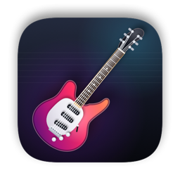
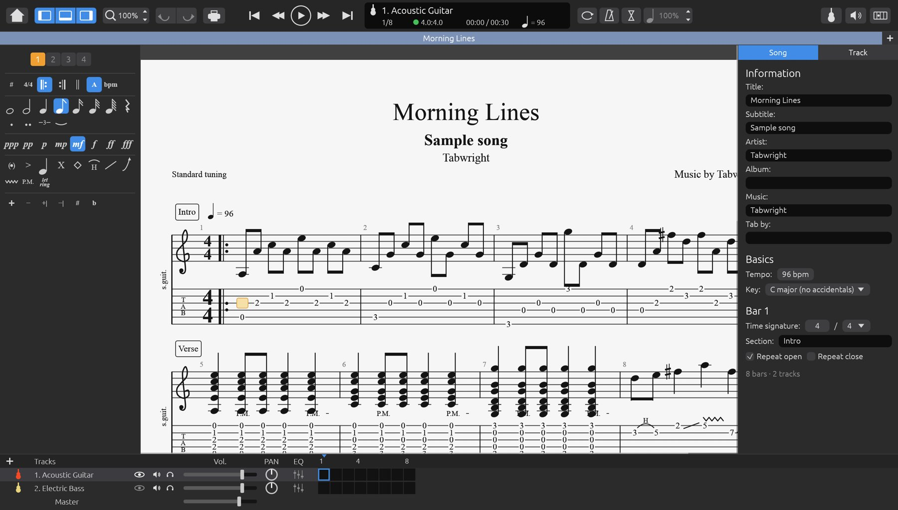

<h1 align="center">Tab Player</h1>

Guitar Pro 파일을 열어 보고, 듣고, 연습하고, 편집하는 무료 macOS 기타 타브 플레이어 
<b><a href="https://jayusop.github.io/TabPlayer/">소개 페이지</a> · <a href="https://github.com/jayusop/TabPlayer/releases/latest">최신 버전 다운로드</a></b>

## 주요 기능

- **Guitar Pro 파일 열기**: .gp3 / .gp4 / .gp5 / .gpx / .gp (GP3–GP8)
- **타브 + 오선보**: A4 페이지 레이아웃, 여러 트랙
- **연습 도구**: A–B 구간 반복, 재생 속도 조절, 메트로놈, 카운트인
- **편집**: 가상 지판, 해머온·슬라이드·벤딩·비브라토·팜뮤트 등 주법 입력
- **페달보드 & 앰프**: 트랙별 이펙터, 볼륨·팬·EQ·뮤트·솔로
- **사운드 출력**: macOS 표준 MIDI, 내장 신스, 외부 MIDI 장치, 악기 플러그인(AU)
- **튜너**: 마이크 입력
- **내보내기**: PDF, MIDI, ASCII 타브, 프린트
- **언어**: 한국어, English, 日本語, 简体中文

## 🎛 SoundCompas로 더 좋은 사운드를

**[SoundCompas](https://jayusop.github.io/SoundCompas/)** 를 함께 설치하면 훨씬 풍부하고 생생한 사운드로 연주를 들을 수 있습니다.
설치한 뒤 Tab Player의 **사운드 출력 → 악기 플러그인 (AU) → SoundCompas**를 선택하세요.

## 다운로드

| Mac | 파일 |
|---|---|
| Apple Silicon (M1 이후) | [TabPlayer-apple-silicon.zip](https://github.com/jayusop/TabPlayer/releases/latest/download/TabPlayer-apple-silicon.zip) |
| Intel | [TabPlayer-intel.zip](https://github.com/jayusop/TabPlayer/releases/latest/download/TabPlayer-intel.zip) |
| Universal (모든 Mac) | [TabPlayer-universal.zip](https://github.com/jayusop/TabPlayer/releases/latest/download/TabPlayer-universal.zip) |

**요구사항:** macOS 12 이상

## 설치

1. ZIP을 풀고 `Tab Player.app`을 **응용 프로그램** 폴더로 옮깁니다.
2. 처음 실행할 때는 앱을 **우클릭 → 열기**로 엽니다.
3. 그래도 열리지 않으면 **시스템 설정 → 개인정보 보호 및 보안 → 그래도 열기**를 누릅니다.

## 문의

문제나 제안은 [Issues](https://github.com/jayusop/TabPlayer/issues)에 남겨 주세요.
이 저장소에는 설명 페이지와 배포 파일만 있으며, 소스 코드는 공개하지 않습니다.

---
Guitar Pro는 Arobas Music의 상표이며, Tab Player는 Arobas Music과 관련이 없는 독립 앱입니다.
